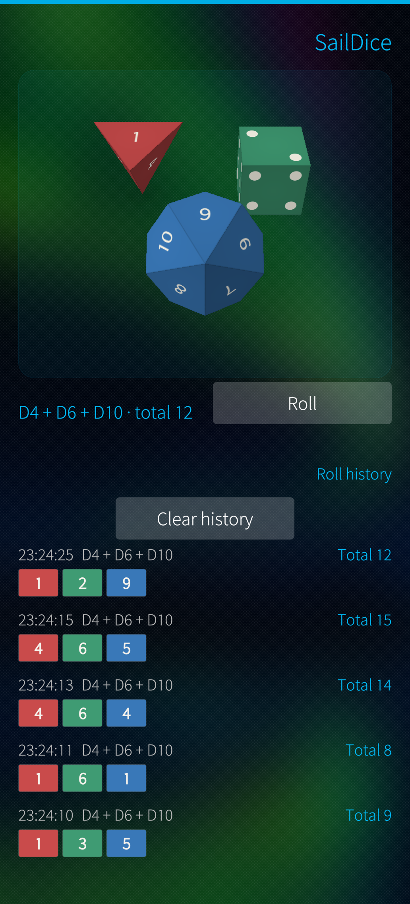
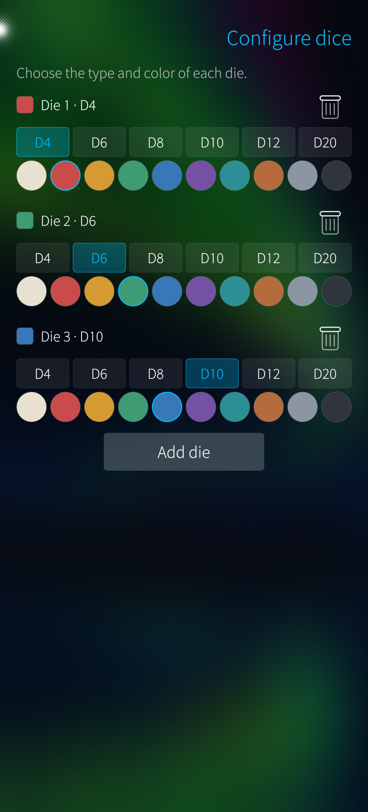
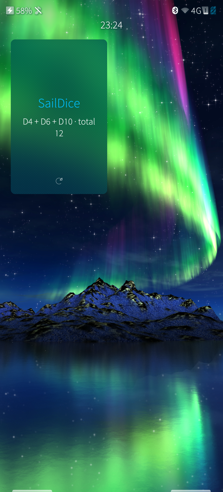

# SailDice

A native Sailfish OS dice roller built around real 3D polyhedral dice.

[](LICENSE)

- D4, D6, D8, D10, D12 and D20.
- Up to 12 dice, with an independent type and color for each one.
- Dice configuration on a second page, available from the pull-down menu.
- Animated rolls that land on the face matching each result.
- Roll action on the application cover, with the latest result shown there.
- Total and per-die breakdown for every roll.
- Session history for the last 50 rolls, with confirmed clearing.
- English interface, Sailfish Silica UI and official hicolor launcher icons.
- No network access, no permissions and no data collection.

The 3D engine is a `QQuickFramebufferObject` using OpenGL ES 2.0. All six
polyhedra and the number/pip texture atlases are generated by the application
itself, so there are no third-party runtime dependencies.

| Main page | Configuration | Cover |
| --- | --- | --- |
|  |  |  |

## Compatibility

- Sailfish OS 5.x.
- Tested on a Jolla Phone 2026 running Sailfish OS 5.2.
- Packages are prepared for `aarch64` and `armv7hl`.

## Build

Install the Sailfish SDK, select a Sailfish OS 5.1 target and, from the project
directory, run:

```bash
sfdk -c target=SailfishOS-5.1.0.11-aarch64 build
sfdk -c target=SailfishOS-5.1.0.11-aarch64 check -s harbour \
  RPMS/harbour-saildice-*.aarch64.rpm
```

For 32-bit devices, clean the build artefacts between targets:

```bash
rm -f ./*.o moc_* Makefile harbour-saildice
sfdk -c target=SailfishOS-5.1.0.11-armv7hl build
sfdk -c target=SailfishOS-5.1.0.11-armv7hl check -s harbour \
  RPMS/harbour-saildice-*.armv7hl.rpm
```

## Tests

The binary includes checks for the polyhedra, landing orientations and RNG
uniformity. It can also load every QML file without a display:

```bash
./harbour-saildice --selftest
./harbour-saildice --qmlcheck
```

Both modes work in the SDK's i486 target, so no device is required.

## Install

```bash
scp RPMS/harbour-saildice-1.0.0-1.aarch64.rpm defaultuser@<device>:/home/defaultuser/
ssh -t defaultuser@<device> \
  'devel-su pkcon install-local -y /home/defaultuser/harbour-saildice-1.0.0-1.aarch64.rpm'
```

The application appears as **SailDice** in the launcher.

## Privacy and security

SailDice works fully offline and stores roll history in memory only. See
[PRIVACY.md](PRIVACY.md) for details and [SECURITY.md](SECURITY.md) to report a
vulnerability privately.

## Contributing

Bug reports and pull requests are welcome. Read [CONTRIBUTING.md](CONTRIBUTING.md)
and [docs/RELEASING.md](docs/RELEASING.md) first.

## Harbour

The store submission copy, metadata, QA steps and package names are documented
in [docs/harbour-listing.md](docs/harbour-listing.md).

## License

SailDice is released under the [MIT License](LICENSE).

Sailfish OS and Jolla are trademarks of Jolla Ltd. This project is not
affiliated with or endorsed by Jolla.
